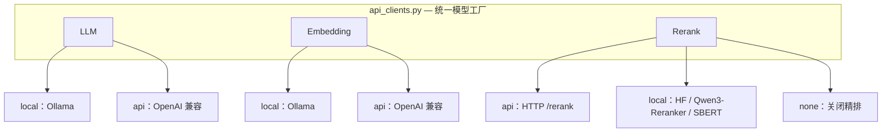
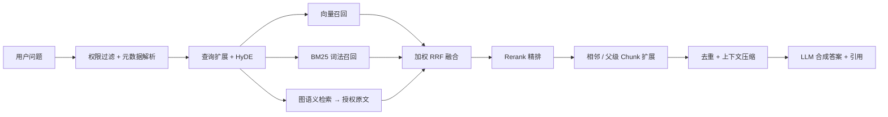

# PCB-RAG 原理与设计

本文收录 PCB-RAG 的设计亮点、系统架构、检索链路各阶段、已知问题与修复记录。
怎么安装和使用，请看项目根目录的 [README](../README.md)。

2026-10-23 的共享检索内核、可恢复入库、图语义召回、引用预算及 WSL 验证记录见 [修复与验证报告](LIGHTRAG_FIXES_WSL_20261023.md)。

## 目录

- [项目亮点](#项目亮点)
- [系统架构](#系统架构)
- [检索链路各阶段](#检索链路各阶段)
- [Agent 元件的设计取舍](#agent-元件的设计取舍)
- [技术栈](#技术栈)
- [目录结构](#目录结构)
- [已知问题（Known Issues）](#已知问题known-issues)
- [此前修复记录](#此前修复记录)
- [开发意义](#开发意义)

## 项目亮点

| 亮点 | 说明 |
| --- | --- |
| **本地 / API 双后端** | LLM、Embedding、Rerank 均支持「本地服务」与「OpenAI 兼容 API」两种后端，通过 `*_BACKEND` 环境变量切换，不锁定厂商 |
| **一键环境补全** | `scripts/setup.sh` 自动创建虚拟环境、安装依赖、生成 `.env`、启动 Milvus，并按后端检查模型可用性 |
| **领域化文档处理** | 面向 PCB 规范、EDA 工具文档与工艺参数，内置编码修复、OCR 乱码清理、结构感知切块与元数据抽取 |
| **混合检索架构** | Milvus 向量检索 + BM25 词法检索 + HyDE 查询扩展 + 加权 RRF 多路融合，提升专业问题召回率 |
| **查询理解** | 意图识别与动态权重、复合问题自动分解、过于具体的问题自动 Step-back 补充背景知识 |
| **Agentic RAG** | 可选的迭代检索：检索 → 充分性判断 → 信息不足则改写查询重检，直到满足或达到迭代上限 |
| **Contextual Retrieval** | 入库时为每个 chunk 注入「文档 · 章节 · 标准号」语境前缀，缓解切块导致的上下文丢失 |
| **可切换精排** | 支持 API 精排（Jina / 硅基流动等）与本地精排（Qwen3-Reranker / cross-encoder / SBERT） |
| **上下文扩展** | 子块参与向量召回，按需读取快照中保存的完整父块与相邻证据；表格保留列头、单位和脚注 |
| **Dify 集成** | 提供符合规范的 FastAPI 外部知识库接口，可直接接入 Dify 工作流或对话应用 |
| **GraphRAG 图检索** | 实体描述、关系描述各有语义索引；图命中回查可授权原文，与向量/BM25 一起融合和精排 |
| **发布与恢复** | 内容及处理配置生成阶段指纹；入库失败保留旧版本，完成校验后原子发布，支持图补建和新集合迁移 |
| **统一证据与引用** | HTTP、SDK、CLI、评测共用检索管道；最终提示词、引用、返回原文与完整请求预算共用 EvidenceBundle |
| **上下文压缩** | 近似去重 + 抽取式压缩 + 字符预算裁剪，在长召回链路上降低 token 消耗 |
| **多租户权限** | 按租户 / 角色 / 组做检索级过滤（向量库表达式 + 内存兜底双层），并支持访问审计 |
| **可观测性** | 结构化 tracing（JSONL）、计数器与延迟分位，`/metrics` 直接暴露 |
| **多模态** | PDF 图片经视觉模型转成可检索描述，表格结构化为 Markdown，列值对应关系不再丢失 |
| **标准工程结构** | `src/pcb_rag` 包结构 + `pyproject.toml`，便于安装、导入与维护 |

## 系统架构

### 模型层：本地 / API 双后端



### 检索链路



## 检索链路各阶段

| 阶段 | 说明 |
| --- | --- |
| 权限过滤 | 严格旧数据模式下将完整 ACL 条件下推到召回；默认旧文档兼容模式保留召回后内存复核，避免不完整的下推条件误删合法证据 |
| 元数据过滤解析 | 从问题中提取 `vendor` / `eda` / `layer_count` / `copper_oz` 等条件，缩小检索范围 |
| 查询理解 | 规则 + LLM 混合的意图识别，输出查询类型与动态检索权重 |
| 查询分解 | 复合问题拆成多个子问题分别召回，缓解多跳问题漏召 |
| 查询扩展 | PCB 同义词与缩写扩展，提升专业术语召回 |
| HyDE 增强 | 生成假设文档参与向量检索，缓解短查询语义稀疏问题 |
| Step-back | 过于具体的问题抽象为上位问题，单独一路召回补充背景知识 |
| 多路召回 | 向量检索与 BM25 词法检索并行执行 |
| 加权 RRF 融合 | 按查询类型动态调整各路线权重并融合排序 |
| Rerank 精排 | 使用 API 或本地 cross-encoder 对候选重排序 |
| 上下文扩展 | 命中 chunk 并入相邻 / 父级 chunk，保持上下文完整 |
| GraphRAG 图检索 | 实体链接命中图谱后取邻域关系与原文依据，作为独立一路（有独立权重与 rank）参与 RRF 融合，并顺带补全多跳事实 |
| 权限复核 | 对召回结果逐条复核，向量库过滤被忽略时也能兜底拦截 |
| 上下文压缩 | 近似去重 → 抽取式压缩（优先保留含数值 / 标准号的句子）→ 字符预算裁剪 |
| 答案合成 | 基于 RAG Prompt 生成答案并标注引用来源 |

## Agent 元件的设计取舍

`pcb_rag.engine.KnowledgeBase` 刻意做了三个取舍：

- **返回逐条证据而不是拼接好的上下文**：否则"信息是否充分"的判断被锁死在元件里，agent 失去再检索的机会。
- **降级状态显式暴露**：静默降级会让 agent 把"某条路没跑起来"误读成"知识库没有"。
- **不保存会话状态**：历史由 agent 传入，元件不在背后攒一份不一致的上下文。

元件与 HTTP 服务共用同一套检索实现和同一个索引实例，两种形态可并行使用。

## 技术栈

| 层次 | 组件 |
| --- | --- |
| 语言 | Python 3.10+ |
| RAG 框架 | LlamaIndex |
| 向量数据库 | Milvus 2.6（Docker Compose 一键启动） |
| 模型服务 | OpenAI 兼容 API / Ollama / HuggingFace Transformers |
| 服务框架 | FastAPI + Uvicorn |
| 外部集成 | Dify External Knowledge API |
| 分词与检索 | jieba 领域词典 + 本地 BM25+ 词法索引 |

## 目录结构

```text
.
├── .env.example                  # 环境变量模板（本地 / API 双后端）
├── .gitlab-ci.yml                # CI：lint + pytest
├── .github/workflows/ci.yml      # GitHub Actions：ruff 静态检查 + 构建 + pytest
├── requirements.txt              # Python 依赖
├── pyproject.toml                # Python 包配置
├── src/pcb_rag/                  # 核心源码包
│   ├── api_clients.py            # LLM / Embedding / Rerank 双后端工厂
│   ├── cache.py                  # 语义缓存（精确匹配 + 向量相似）
│   ├── chunk_quality.py          # chunk 信息密度评估（低价值块标记）
│   ├── context_budget.py         # 上下文 token 预算与三段式组装
│   ├── engine.py                 # Agent 元件：结构化检索 / 问答 / 工具定义
│   ├── fusion.py                 # 加权 RRF 与配额制融合（纯逻辑）
│   ├── graph_rag.py              # 实体关系图：抽取、存储、图检索
│   ├── ingest.py                 # 文档预处理、切块与入库
│   ├── query.py                  # 检索链路与交互式问答
│   ├── preprocess_docs.py        # 编码修复与乱码清理
│   ├── webui/index.html          # Web 问答界面（单文件，零构建）
│   └── dify_external_api.py      # Dify 外部知识库 API 服务
├── examples/                     # 作为元件接入 agent 的示例与说明
├── tests/                        # 单元测试
├── eval/                         # 评测体系（黄金集 + 四指标）
│   ├── build_golden_dataset.py   # 数据集构建
│   ├── metrics.py                # 忠实度 / 相关性 / 精确率 / 召回率
│   └── evaluate.py               # 评测主脚本
├── scripts/                      # 一键安装与运行脚本
│   ├── setup.sh                  # 环境一键补全
│   ├── check_env.py              # 环境自检
│   ├── run_ingest.sh             # 文档入库
│   ├── run_query.sh              # 交互式问答
│   ├── serve_api.sh              # 启动 API 服务
│   └── run_optimized.sh          # 交互式参数配置脚本
├── docker/milvus/docker-compose.yml
├── data/README.md                # 数据目录说明
└── docs/                         # 配置、集成与优化文档
```

## 已知问题（Known Issues）

列在这里的目的是**可证伪**：每条都写清现象、根因、当前状态与彻底修法，便于接手的人复核。

| # | 现象 | 根因 | 当前状态 |
| --- | --- | --- | --- |
| 0 | 旧 r2 消融使用失效的向量索引 | NVIDIA query/passage 编码契约错误 | 已修，2026-10-20 已有重跑的检索基线与消融；10 月 23 日本轮代码仍需新效果基线，不能复用旧成绩作为改进结论 |
| 1 | 评测脚本与评测报告未入库 | `eval/reports/`、`eval/*.json(l)` 被 `.gitignore` 排除（数据集含语料原文，不宜公开）；`eval/evaluate_recall.py` 亦未纳入版本控制 | **未修（唯一需要人工决策的一条）**：脱敏后提交脚本 + 报告摘要，或在 README 给出「数据集规模 / 该集指标 / 脚本版本」对照表。在提交之前，README 里的所有 MRR / Hit@K / NDCG 数字都无法被第三方复现 |
| 2 | 指标绝对值不可跨数据集比较 | 仓库内多版数据集互不重合（`eval_dataset.json` / `eval_dataset_146.json`）；真值由 chunk 反推问题生成，chunk 按定义相关 | 只用于**同数据集内**的配置对比；换集必须重跑基线。生成侧偏差方向明确：共享词汇使 Hit/Recall 系统性**高估** |
| 3 | LLM 出题 / 判卷与生成同源 | 共用模型会放大同源偏差 | 生成评测支持 `JUDGE_*` 独立 API 模型，软匹配支持 `SOFT_JUDGE_*`；仍**需人工抽检 20~30 条校准并报告 judge 与人评一致率** |
| 4 | 每请求独立建线程池 | 多入口重复调度检索 | 已改为共享有界执行器与服务并发/队列边界，排队也计入总 deadline |
| 5 | SSE 断开后的后台工作 | 已开始的同步 HTTP 调用无法强制终止 | 已传播断开/超时并取消待执行工作，停止后续响应；运行中的调用继续占用工作槽直到结束，并记录迟到用量，不能承诺供应商立即停止计费 |
| 6 | 分路贡献无 ablation | 只有整体开关对比，没有关掉单路的对照实验 | 部分修：`fusion.route_contribution()` 提供"这条只靠哪一路进来"的归因；`quota_rrf_fuse` 补了"单路失效不挤占另一路"的回归测试。完整 ablation 表待新基线重跑补齐 |
| 7 | parent 指向首个子块 | 未存储完整父块文本 | 新版快照已保存完整 parent，子块单独嵌入；检索按 ID 读取真实父节并复核权限/版本。旧集合须迁移 |
| 8 | O(n²) 的其它潜在热点 | 已修 `_parent_child_parse` 的邻居查找（此前 1e4 chunk 约 30~60s）；其它循环未逐一审计 | 未完全修 |

## 此前修复记录

下表保留早期实现记录；2026-10-23 的共享管道与迁移行为以 [修复报告](LIGHTRAG_FIXES_WSL_20261023.md) 为准。

| 问题 | 现象 | 修法 |
| --- | --- | --- |
| `INGEST_OVERWRITE` 与 manifest 冲突 | 重建集合后清单未失效 → `to_process` 为空 → **库被清空且什么都不插入**，后续增量继续空转 | `incremental.plan_ingest()`：overwrite 时忽略清单并写入真实指纹 |
| 增量指纹用 mtime | `git clone` / `cp -r` 改写 mtime → 全量误判重嵌入 | 改为 size 快筛 + blake2b 内容哈希，路径不进指纹 |
| CLI HyDE 键错位 | `primed_queries` 以 `expanded_q` 为键，却用 `hyde_q` 发起查询 → 原始查询没进检索、BM25 被喂 LLM 长文 | 改用 `expanded_q` 发起查询（与 eval / API 一致） |
| 图融合量纲 | 图规则分（0.2~1.0）× 0.35 与 RRF 分（~0.02）同池排序 → 图节点无条件霸榜 | 改为独立的 rank-based RRF 路；API 侧再加独立配额 `GRAPH_EVIDENCE_MAX` |
| BM25 不重载 | 长驻 API 只在启动时建一次索引 → 新文档缺一整路投票 | 入库写 `LEXICAL_RELOAD_STAMP`，API 按 mtime 惰性后台重载 |
| BM25 文档侧 tf 被压成 0/1 | `cut` + `cut_for_search` 合并去重 → k1 完全失效，与"调高 k1 增强词频"的注释矛盾 | `cut_words` 保留词频，`search_words` 只补新词 |
| IDF 高频词 postings 截断 | `postings[:5000]` 按入库顺序截断 → 新文档永远进不了高频词候选 | 默认不截断（DF>80% 已在打分阶段过滤） |
| judge 静默降级为 0 分 | judge 失败 / 无可判定陈述都返回 0.0 → 所有生成侧指标被低估且无人察觉 | 三态返回（`None` = 评测失败），汇总分列 evaluated / failed，失败率超阈值标记 `invalid` |
| ACL 合并把 OR 摊平 | ACL 的 `tenant OR public` 被并进外层 AND → 本租户私有文档全部不可见 | `merge_filters` 保留 OR 子树（已提交，含真实编译表达式回归测试） |
| 缓存跨租户复用 | 缓存 key 不含访问主体 → 语义命中会跨租户返回 | scope 前缀 + 同 scope 语义匹配；未传 scope 时告警 |
| `/api/ask` 绕过兜底 | 直调 `_retrieve_nodes` → 少了内存侧权限复核，且 GraphRAG 完全不生效 | 两步都下沉到 `_retrieve_nodes` 末尾，所有端点共享 |
| 默认不安全 | `DIFY_API_TOKEN=change-me` 可启动；`ACL_TRUST_HEADERS` 默认信任自报头（自报 admin 即读全库）；CORS 通配 | Token 缺失/占位时拒绝启动；信任头默认关闭 + 需显式 ACK；CORS 改白名单 |
| `/health` 泄露配置 | 无鉴权的 `/health` 返回租户字段名、admin 角色、后端地址 | 拆为 `/health`（探针用）与 `/health/detail`（需鉴权） |
| 纯逻辑不可测 | 融合 / 增量比对与重型 import 绑在一起，测试只能 `importorskip` 静默跳过 | 下沉到 `pcb_rag/fusion.py`、`pcb_rag/incremental.py`，新增 60+ 用例；CI 增加依赖自检让"被跳过"变成硬失败 |
| `FUSION_MODE` 空转 | 三份文档把它当 v1.3 核心变更，代码里只用来挑打印字符串 | 代码与文档同步标注为"不改变行为"，CLI 启动横幅显式提示 |

## 开发意义

- 设计并实现面向 PCB 领域文档的 RAG 问答系统，支持规范文档入库、向量检索、BM25 召回、多路融合、Rerank 精排与答案生成。
- 基于 LlamaIndex、Milvus、FastAPI 搭建知识库服务，模型层抽象出「本地 / OpenAI 兼容 API」双后端，可按部署环境自由切换。
- 针对 PCB 专业术语、工艺参数和 EDA 工具场景设计元数据抽取、查询过滤和混合检索策略，提升专业问题召回与回答相关性。
- 整理为可复现工程：提供标准 Python 包结构、环境变量模板、Docker Compose 与一键 setup/run 脚本。
